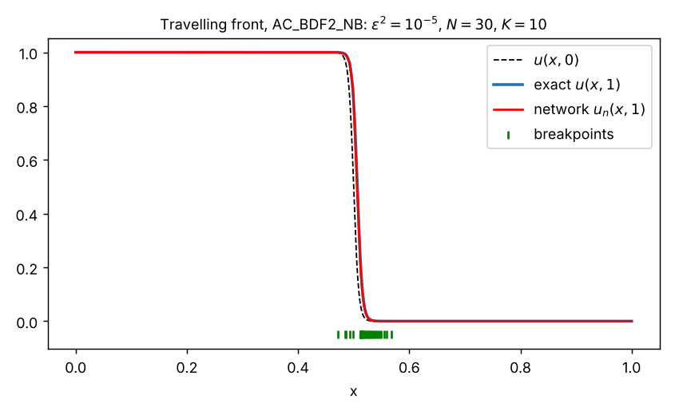

# Allen–Cahn equation

Ritz neural-network time stepping for the 1D Allen–Cahn equation

$$
u_t \;=\; \varepsilon^2 u_{xx} \;-\; F'(u), \qquad F'(u) = u^3 - u,
\qquad x\in[a,b],\; t\in(T_{\text{init}},T_{\text{final}}],
$$

with initial datum $u(x,0)=u_0(x)$. The solution at each time level is a shallow ReLU
network $u_n^k(x) = \alpha_k + \sum_{i=0}^N c_i^k\,\sigma(x-b_i^k)$ (see the
[top-level README](../README.md) for the network and the shared Newton algorithm).
Every time step is written as the minimization of an energy, which is then minimized
over the network parameters, warm-started from the previous time level.

## Contents

| File | Description |
|---|---|
| [`NN/LS.py`](NN/LS.py) | `LS`: $L^2$ best approximation of $u_0$ by the network. Produces `theta_init` for the time steppers. |
| [`NN/AC_CSS_DB.py`](NN/AC_CSS_DB.py) | `AC_CSS_DB`: first-order **convex-splitting scheme**, Dirichlet BCs. Errors measured against a pseudo-spectral reference. |
| [`NN/AC_CSS_NB.py`](NN/AC_CSS_NB.py) | `AC_CSS_NB`: convex-splitting scheme, Dirichlet BC at $a$, homogeneous Neumann at $b$. Errors measured against the exact travelling wave. |
| [`NN/AC_BDF2_DB.py`](NN/AC_BDF2_DB.py) | `AC_BDF2_DB`: second-order **stabilized IMEX-BDF2**, Dirichlet BCs, spectral reference. |
| [`NN/AC_BDF2_NB.py`](NN/AC_BDF2_NB.py) | `AC_BDF2_NB`: stabilized IMEX-BDF2, Dirichlet at $a$ / Neumann at $b$, exact reference. |
| [`NN/test1.py`](NN/test1.py) | Driver for **Test 1** (travelling front). |
| [`NN/test2.py`](NN/test2.py) | Driver for **Test 2** (two interfaces + perturbation). |
| [`SpectralMethods/IMEX_BDF2_Periodic.py`](SpectralMethods/IMEX_BDF2_Periodic.py) | Stand-alone Fourier pseudo-spectral IMEX-BDF2 solver (periodic), the same scheme used internally to build reference solutions. |

Naming: **CSS** = convex-splitting scheme, **BDF2** = stabilized IMEX-BDF2;
**DB** = Dirichlet boundary conditions at both ends, **NB** = Dirichlet at $x=a$ and
(natural) Neumann condition at $x=b$.

---

## Time discretizations

Let $\Delta t = (T_{\text{final}}-T_{\text{init}})/K$ and $u^k \approx u(\cdot,t_k)$.

### Convex splitting (CSS, first order, energy stable)

The convex part $u^4/4$ of $F(u)=\tfrac14(u^2-1)^2$ is treated implicitly and the
concave part explicitly:

$$
\frac{u^{k}-u^{k-1}}{\Delta t} = \varepsilon^2 u^{k}_{xx} - (u^{k})^3 + u^{k-1}.
$$

Each step is the Euler–Lagrange equation of the convex energy (`J_NN` in `AC_CSS_DB`)

$$
J_k(v) = \int_a^b \Big( \frac{\varepsilon^2}{2}|v'|^2 + \frac{1}{2\Delta t}v^2
+ \frac14 v^4 - \Big(1+\frac{1}{\Delta t}\Big)u^{k-1} v \Big)\,dx .
$$

Since $J_k$ is nonlinear in $v$, the linear parameters are obtained with a few
Newton iterations per step (reaction weight $3u_n^2 + 1/\Delta t$ in the Hessian).

### Stabilized IMEX-BDF2 (second order)

With stabilization constant $S$ (`shift`, default $2$) and the extrapolation
$\tilde u = 2u^{k-1}-u^{k-2}$:

$$
\frac{3u^k-4u^{k-1}+u^{k-2}}{2\Delta t} = \varepsilon^2 u^k_{xx}
- \big(2F'(u^{k-1}) - F'(u^{k-2})\big) - S\,(u^k - \tilde u).
$$

The left-hand operator is linear in $u^k$, so the energy is quadratic,

$$
J_k(v) = \int_a^b \Big( \frac{\varepsilon^2}{2}|v'|^2 + \frac12\Big(\frac{3}{2\Delta t}+S\Big)v^2 - g_k\,v \Big)\,dx,
$$
$$
g_k = \Big(\frac{2}{\Delta t}+2S+2\Big)u^{k-1} - \Big(\frac{1}{2\Delta t}+S+1\Big)u^{k-2} - 2(u^{k-1})^3 + (u^{k-2})^3 ,
$$

and the linear parameters are obtained with a single linear solve per Newton step.
For the first step $u^{-1}:=u^0$.

Integrals involving previous time levels are split at the breakpoints of the previous
networks (and, for BDF2, of the current one), so that the integrand is a polynomial on
every quadrature cell.

### Boundary conditions

* **DB**: $u(a,t)=\alpha$ is built into the network bias, and $u(b,t)=\beta$ is imposed
  with the penalty $\tfrac{\gamma}{2}(u_n(b)-\beta)^2$ (`gamma`, default $10^4$).
  $\alpha=u_0(a)$ and $\beta=u_0(b)$ are kept constant in time.
* **NB**: the bias is updated each step, $\alpha_k=u(a,t_k)$ from the exact solution,
  and the homogeneous Neumann condition at $b$ is natural (no penalty needed).

---

## Test problems

### Test 1 – travelling front (`test1.py`, NB solvers, `u_id = 2` in `LS`)

The exact solution is the travelling wave

$$
u(x,t) = \frac12 - \frac12\tanh\!\Big(\frac{x-\tfrac12-st}{2\sqrt2\,\varepsilon}\Big),
\qquad s = \frac{3\varepsilon}{\sqrt2},
$$

which solves $u_t=\varepsilon^2u_{xx}-(u^3-u)$ exactly (the stable state $u=1$
invades the unstable state $u=0$). Default parameters: $[a,b]=[0,1]$,
$\varepsilon^2=10^{-5}$, $N=30$, $T_{\text{final}}=1$, `AC_CSS_NB` with $K=10000$
(or `AC_BDF2_NB` with $K=100$). Reported errors: relative $H^1$-seminorm and $L^2$
errors against the exact solution.



*`AC_BDF2_NB` with $N=30$ and only $K=10$ time steps up to $t=1$ (initialised by
`LS`): the breakpoints follow the moving interface. Relative errors at $t=1$:
$1.7\times10^{-1}$ in the $H^1$ seminorm and $4.8\times10^{-3}$ in $L^2$.*

### Test 2 – two interfaces (`test2.py`, DB solvers, `u_id = 1`)

$$
u_0(x) = \tanh\!\Big(\frac{x-0.25}{\sqrt2\,\varepsilon}\Big)
- \tanh\!\Big(\frac{x-0.75}{\sqrt2\,\varepsilon}\Big) - 1 + 0.1\sin(2\pi x),
$$

on $[0,1]$ with $\varepsilon^2=10^{-7}$, $N=25$, `AC_CSS_DB` with $K=150$,
$T_{\text{final}}=1.5$ (or `AC_BDF2_DB` with $K=250$, $T_{\text{final}}=2.5$).
The reference solution is computed at construction time by the pseudo-spectral
IMEX-BDF2 solver (`spectralSolution`) on `n` grid points with `nt` time steps.
Reported errors: relative discrete $L^2$, $L^\infty$ and $H^1$-seminorm errors.

Other initial data are available in the DB solvers through `u_id`:
`2` → $\sin(2\pi x)$, `3` → $x^2\cos(\pi x)$. The NB solvers implement only the
travelling wave of Test 1 (for any `u_id`).

---

## API reference

### `LS(N, a=0.0, b=1.0, u_id=1, eps=1)`

$L^2$ projection of $u_0$ onto the network (minimizes $\tfrac12\|u_n-u_0\|_{L^2}^2$).

* `Newton(max_itr=100, lr=1, ls=False, tau_1=1e-8, stop=True, stopping_tol=1e-9)` –
  alternating linear solve / Newton step on the breakpoints. `ls=True` enables a
  bounded scalar line search on the $L^2$ error. Stops when the residual is below
  `stopping_tol` (if `stop`).
* Attributes after the run: `theta` (pass it to the time steppers), `loss`
  (relative $L^2$ errors), `residual`.
* `plot()`, `plot_no_vlines()`.

`u_id`: `1` → Test 2 datum, `2` → Test 1 datum, otherwise a Gaussian bump.

### Time steppers

```python
AC_CSS_DB (N, K, a=-1.0, b=1.0, gamma=1e4, u_id=1, Tinit=0, Tfinal=0.1, eps=1, n=10000, nt=10000)
AC_BDF2_DB(N, K, a=-1.0, b=1.0, gamma=1e4, u_id=1, Tinit=0, Tfinal=0.1, eps=1, n=10000, nt=1000, shift=2.0)
AC_CSS_NB (N, K, a=-1.0, b=1.0,            u_id=1, Tinit=0, Tfinal=1,   eps=1, n=10000)
AC_BDF2_NB(N, K, a=-1.0, b=1.0,            u_id=1, Tinit=0, Tfinal=1,   eps=1, n=10000, shift=2.0)
```

| Parameter | Meaning |
|---|---|
| `N` | number of neurons is `N+1` (`N` movable breakpoints) |
| `K` | number of time steps |
| `a`, `b` | spatial interval |
| `eps` | interface parameter $\varepsilon$ (the PDE uses $\varepsilon^2$) |
| `Tinit`, `Tfinal` | time interval |
| `gamma` | penalty for the Dirichlet condition at $x=b$ (DB only) |
| `shift` | stabilization constant $S$ (BDF2 only) |
| `n` | number of evaluation/reference grid points |
| `nt` | time steps of the spectral reference (DB only); `nt/K` must be an integer |
| `u_id` | selects the initial datum / exact solution |

(The constructors also accept `alpha`, `beta` arguments, and the NB classes a `gamma`
argument, which are not used: the boundary values are taken from the initial datum /
exact solution.)

**`Newton(theta_init, max_itr, lr=1, tau_1, stopping_tolerance, stop=False)`** –
runs the `K` time steps. At each step it solves for $c$, then performs up to
`max_itr` Newton iterations on $b$ (with redistribution of dead neurons); if `stop`
is set it exits early once the residual drops below `stopping_tolerance`. It
animates the solution and prints errors and gradient norms at every step.
(The NB versions have no `lr` argument.)

**Plots:** `plot()` (final time); the CSS classes also store the history of the
parameters in `B`, `C` and provide `plot_3d()` (space–time surfaces of the reference
and network solutions).

### Spectral reference solver (`SpectralMethods/IMEX_BDF2_Periodic.py`)

A script (no class) implementing the same stabilized IMEX-BDF2 scheme with a
Fourier pseudo-spectral discretization:

$$
\Big(1+\tfrac{2\Delta t}{3}(S-\varepsilon^2\hat\Delta)\Big)\hat u^{k}
= \frac{4\hat u^{k-1}-\hat u^{k-2}}{3}
- \frac{2\Delta t}{3}\big(2\hat f^{k-1}-\hat f^{k-2}\big),
\qquad f = u^3-(1+S)u .
$$

Parameters (`dt`, `tmax`, `n`, `eps`, `shift`, initial datum) are set at the top of
the file; it plots the solution every 20 steps. $S>1.6$ is stable in practice
(comment in the code).

---

## Practical notes

* Run the drivers from inside `NN/` (they use `from LS import *`, etc.).
* The default tests are long: `test1.py` uses $K=10000$ time steps. For a quick check
  reduce `K` and `max_itr`.
* The DB solvers build the full spectral reference (`nt × n` array) in the
  constructor; with the defaults this is $10^4\times10^4$ doubles (~800 MB) for
  `AC_CSS_DB`. Reduce `n`/`nt` if memory is limited.
