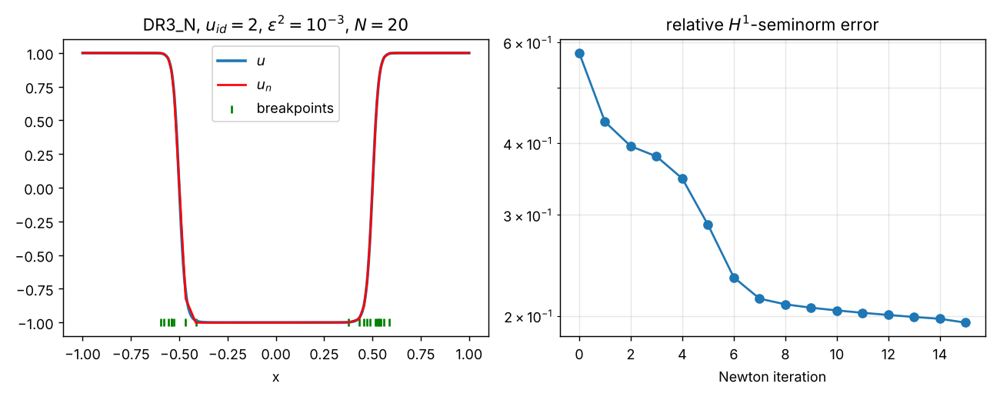

# Semilinear diffusion–reaction problem

Ritz neural-network solvers for the steady, singularly perturbed semilinear
diffusion–reaction equation with cubic reaction ("DR3")

$$
-\varepsilon^2 u'' + u^3 + u = f \quad \text{in } (a,b),
\qquad u(a) = \alpha,
$$

with either a Dirichlet or a Neumann condition at $x=b$. The solution is approximated
by a shallow ReLU network $u_n(x)=\alpha+\sum_{i=0}^N c_i\,\sigma(x-b_i)$ (see the
[top-level README](../README.md)), trained by minimizing the Ritz energy with the
structure-exploiting Newton method.

## Contents

| File | Class | Boundary condition at $x=b$ |
|---|---|---|
| [`DR3_D.py`](DR3_D.py) | `DR3_D` | Dirichlet $u(b)=\beta$, imposed by a penalty $\gamma$ |
| [`DR3_N.py`](DR3_N.py) | `DR3_N` | Neumann $u'(b)=\beta$ (natural BC) |
| [`mainDR3.py`](mainDR3.py) | – | driver script |

In both cases $u(a)=\alpha$ is imposed exactly through the network bias.

## Energy functionals

**Dirichlet (`DR3_D`)**

$$
J(v) = \int_a^b \Big(\frac{\varepsilon^2}{2}|v'|^2 + \frac14 v^4 + \frac12 v^2 - f\,v\Big)dx
\;+\; \frac{\gamma}{2}\big(v(b)-\beta\big)^2,
\qquad \beta = u(b),\; \gamma = 10^4 \text{ by default}.
$$

**Neumann (`DR3_N`)**

$$
J(v) = \int_a^b \Big(\frac{\varepsilon^2}{2}|v'|^2 + \frac14 v^4 + \frac12 v^2 - f\,v\Big)dx
\;-\; \varepsilon^2 \beta\, v(b),
\qquad \beta = u'(b).
$$

$J$ is strictly convex in $v$, and its minimizer solves the boundary-value problem
above. The algorithm (see the top-level README) alternates:

1. **Linear parameters** – Newton's method for $c$; the Hessian is the tridiagonal
   stiffness matrix $\varepsilon^2/h$ plus the mass matrix weighted with
   $3u_n^2+1$ (Simpson, Simpson 3/8 and Boole quadrature on each cell,
   `s0_vector`, `s1_vector`, `s2_vector`), transformed to the ReLU basis
   (`M1_inv`, `solveC`). The Dirichlet penalty adds a rank-one term handled by
   Sherman–Morrison. The very first guess for $c$ comes from a linear problem
   (`init_fc`, `initSolverC`), followed by up to 50 (`DR3_D`) / 100 (`DR3_N`) Newton
   iterations.
2. **Breakpoints** – Newton step $b \leftarrow b + \text{lr}\cdot p$ with
   $p = -(SD+\Lambda)^{-1} g$, where $\Lambda_i = u_n(b_i)^3+u_n(b_i)-f(b_i)$
   (`hessianSolver`).
3. **Redistribution** of dead / collapsed neurons and re-solve for $c$
   (`redistribute_neurons`).

## Manufactured solutions (`u_id`)

| `u_id` | exact solution $u(x)$ | typical domain | classes |
|---|---|---|---|
| 1 | $x\big(e^{-(x-1/3)^2/0.01} - e^{-(4/9)/0.01}\big)$ (right-hand side derived for $\varepsilon = 1$) | $[0,1]$ | D, N |
| 2 | $\tanh\!\big(\tfrac{x^2-1/4}{\varepsilon}\big) - \tanh\!\big(\tfrac{3}{4\varepsilon}\big) + 1$ — two interior layers at $x=\pm\tfrac12$ | $[-1,1]$ | D, N |
| 3 | $\tanh\!\big(\tfrac{x-1/2}{\sqrt2\,\varepsilon}\big)$ — one interior layer | $[0,1]$ | N |

The right-hand side $f$ is defined in `f(x)` from the exact solution, and the
boundary data $\alpha$, $\beta$ are taken from it.

## Errors and output

* `h1_error` – relative $H^1$-seminorm error $|u-u_n|_{H^1}/|u|_{H^1}$ after every
  iteration. It is evaluated without quadrature of $u_n$ using
  $|u-u_n|_{1}^2 = |u_n|_1^2 + |u|_1^2 - 2\sum_j d_j\,(u(b_{j+1})-u(b_j))$.
* `residual` – $\|(\nabla_c J,\, c\odot g)\|_2$ after every iteration.
* Printed *rate* – empirical convergence rate $-\log(\text{err})/\log(N+1)$ with
  respect to the number of neurons.

## API

```python
DR3_D(N, a=0, b=1, u_id=1, eps=1, gamma=1e4)
DR3_N(N, a=0, b=1, u_id=1, eps=1)
```

| Parameter | Meaning |
|---|---|
| `N` | `N+1` neurons; breakpoints initialised uniformly, $b_0=a$ fixed |
| `a`, `b` | interval |
| `u_id` | manufactured solution (table above) |
| `eps` | $\varepsilon$ (the equation uses $\varepsilon^2$) |
| `gamma` | Dirichlet penalty at $x=b$ (`DR3_D` only) |

Methods:

* `Newton(max_itr=100, lr=1, tau_1=1e-5)` (`DR3_D`) /
  `Newton(max_itr=100, lr=1, tau_1=1e-6)` (`DR3_N`) – runs the solver; `lr` is the
  step length for the breakpoints and `tau_1` the threshold below which a neuron
  ($|c_i|<\tau_1$) is considered dead and is redistributed.
* `plot()` – exact vs. network solution with breakpoints marked.
* `plot_no_vlines()` – same, with breakpoints shown as ticks.
* `u`, `u_prime`, `f` – exact solution, its derivative and the right-hand side.

## Example

```python
import numpy as np
from DR3_N import DR3_N   # run from inside SemilinearDR/

solver = DR3_N(N=20, u_id=2, a=-1, b=1, eps=np.sqrt(1e-3))
solver.Newton(max_itr=15, lr=1, tau_1=1e-8)
solver.plot_no_vlines()
```



*Output of the example above: the 20 breakpoints cluster in the two interior layers,
and the relative $H^1$-seminorm error decreases over the Newton iterations.*

`mainDR3.py` runs `DR3_N` with `N=20`, `u_id=2` on $[-1,1]$ with
$\varepsilon^2=10^{-7}$ and `max_itr=0` (only the initial solve for $c$ on a uniform
mesh). Increase `max_itr` to move the breakpoints with Newton's method.

## Known issues

These are documented here and left untouched in the code:

* **Missing linear reaction term in some right-hand sides.** The solvers discretize
  $-\varepsilon^2u''+u^3+u$, but `f` omits the `+ u(x)` term in `DR3_D` for
  `u_id = 1, 2` and in `DR3_N` for `u_id = 1`. In those cases the stated `u` is the
  exact solution of $-\varepsilon^2u''+u^3=f$, not of the problem being solved, so
  the reported errors are measured against a slightly different function.
  (`DR3_N` with `u_id = 2, 3` is consistent.)
* **`DR3_N.u_prime` for `u_id = 3`** is missing the square of the
  $\operatorname{sech}$ factor; the correct derivative is
  $\operatorname{sech}^2\!\big(\tfrac{x-1/2}{\sqrt2\varepsilon}\big)/(\sqrt2\varepsilon)$.
  This affects $|u|_{H^1}$ (hence the relative error) and $\beta=u'(b)$.
* **`DR3_N.gradC`** includes the Neumann boundary term only for `u_id = 2`. For the
  other examples $u'(b)\approx 0$, so the effect is negligible.
* **`plot_error()`** refers to attributes (`errorNewt`, `refinement_list`) that are
  not defined in these classes; use `h1_error` / `residual` instead.
